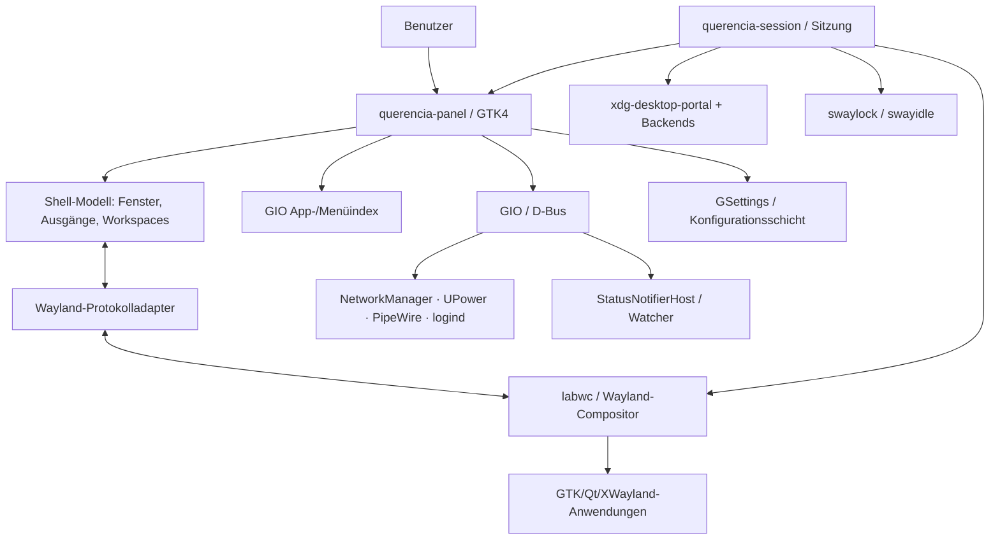
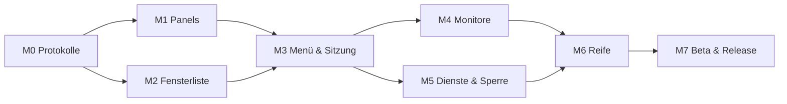

# GNOME 2 neu gedacht: Implementierungsplan für einen klassischen GTK4-/Wayland-Desktop

**Arbeitstitel:** Classic2 (vorläufig; kein offizielles GNOME-Projekt)  
**Dokumenttyp:** Architektur-, Implementierungs- und Validierungsplan  
**Stand:** 13. Oktober 2026  
**Status:** Technischer Vorschlag, keine abgeschlossene Implementierung  
**Ausgangsidee:** Das Bediengefühl von GNOME 2 mit moderner GTK4-Oberfläche, nativem Wayland, einer konservativen Produktphilosophie und sinnvoll eingesetzter KI neu aufbauen.

**Projektname seit R1 (14.10.2026):** Querencia Desktop. Der Arbeitstitel „Classic2“ in diesem Dokument und in den Protokollen M1/M2 bezeichnet dasselbe Projekt; Bezeichner `querencia-*` stehen für die geplanten Artefakte, die installierte Sitzung trägt bis zur Migration R2 die alten Namen.

> **Kernaussage:** Das Vorhaben ist technisch realistisch, **wenn zunächst eine klassische Shell auf einem vorhandenen Wayland-Compositor entsteht**. Eine 1:1-Portierung der gesamten historischen GNOME-2-Codebasis oder die gleichzeitige Entwicklung eines eigenen Compositors wäre für einen kleinen Projektstart eine schlechte Wette. Ein erster überzeugender Prototyp ist deutlich kleiner als ein vollständig alltagstauglicher Desktop.

---

## 0. Management-Zusammenfassung

### Empfohlene Entscheidung

1. **Produktziel:** GNOME-2-Bedienmodell erhalten, alte Interna nicht konservieren.
2. **Architektur:** eigener GTK4-Panel-/Shell-Prozess, zunächst auf **labwc** statt eigenem Wayland-Compositor.
3. **Technologie:** **Rust + gtk4-rs + gtk4-layer-shell** für Shell und Kernlogik; Wayland-Protokolle für Taskleiste, Arbeitsflächen und Ausgänge; GIO, D-Bus und vorhandene Systemdienste für Integration.
4. **Bewusster Zuschnitt:** zuerst zwei Panels, Applications/Places/System, Fensterliste, Uhr und Arbeitsflächen; kein eigener Dateimanager, keine eigene Audiosteuerung und vorerst kein eigenes Applet-Ökosystem.
5. **Entwicklungsprinzip:** funktionierende Funktionen einfrieren, Regressionen automatisiert nachweisen, APIs bewusst klein halten, KI-Änderungen wie fremde Pull Requests prüfen.
6. **MVP-Grenze:** nicht „vollständiger Linux-Desktop“, sondern eine separat startbare, wiederholbar getestete labwc-Sitzung mit GNOME-2-ähnlicher Bedienung und sicheren Rückfallmöglichkeiten.

### Technische Machbarkeit auf einen Blick

| Teilproblem | Machbarkeit | Wichtigste Bedingung |
|---|---|---|
| Zwei GNOME-2-artige Panels | Hoch | Compositor unterstützt `wlr-layer-shell` |
| Klassisches Applications-Menü | Hoch | Freedesktop-Desktop-Dateien korrekt auswerten |
| Laufende Fenster anzeigen und aktivieren | Hoch **unter labwc** | `wlr-foreign-toplevel-management` vorhanden |
| Fensterliste auf *beliebigem* Wayland-Desktop | Nicht generell möglich | Wayland bietet keine universelle Taskleisten-API |
| Arbeitsflächenumschalter | Gut, compositorabhängig | `ext-workspace-v1` oder Adapter |
| Mehrmonitorbetrieb | Gut | Pro Ausgabe eigene Panels und Hotplug-Zustandsmodell |
| System-Tray | Mittel | StatusNotifierItem über D-Bus, Watcher-/Host-Rollen |
| Sitzung, Portale, Sperren und Energiemanagement | Mittel bis anspruchsvoll | Vorhandene Dienste sauber integrieren und testen |
| Vollständige GNOME-2-Parität inkl. Applets | Aufwendig | Langfristige Kompatibilitäts- und Wartungsarbeit |
| Eigener Wayland-Compositor | Technisch möglich, aber teuer | **Nicht** Bestandteil der ersten Version |

### Erwartbare Größenordnung

Dies sind **Planungsannahmen, keine gemessenen Zeiten**. Geschätzt für eine technisch erfahrene Person mit KI-Unterstützung, inklusive Fehlersuche und Tests:

- **Machbarkeitsexperiment:** etwa 30–70 Arbeitsstunden.
- **Panel-Prototyp mit echter Fensterliste:** insgesamt etwa 100–200 Stunden.
- **Abgrenzbarer MVP mit benutzbarer Sitzung:** insgesamt grob **250–450 Stunden**.
- **Alltagstaugliche Beta mit Mehrmonitor-, Sitzungs- und Portalintegration:** grob **550–1.000 Stunden insgesamt**.
- **Polierte, distributionsübergreifende Version 1.0:** zusätzlicher Aufwand, der maßgeblich vom gewünschten Funktionsumfang, von Hardwareproblemen und von verfügbarer Wartung abhängt.

KI kann Schreib-, Analyse- und Testaufwand verringern. Sie hebt Integrations-, Hardware- und Sicherheitsrisiken aber nicht auf. Für eine nebenberufliche Einzelperson mit 10 Stunden/Woche wären selbst 250 Stunden bereits rund sechs Monate; ein kontinuierlich finanziertes kleines Team könnte schneller sein.

---

## 1. Produktvision und Leitprinzipien

### 1.1 Warum das Projekt existiert

Ein klassischer Desktop soll kein Selbstzweck und kein Nostalgie-Skin sein. Er soll eine gut verstandene Arbeitsweise liefern:

- sichtbar statt versteckt;
- dauerhaft erreichbares Applications-/Places-/System-Menü;
- konventionelle Fenster mit sichtbaren Aufgaben und einer Fensterliste;
- klassische Arbeitsflächen, die nicht erst über eine Overview-Oberfläche bedient werden müssen;
- vorhersehbare Fensterpositionen und Monitornutzung;
- kurze Reaktionszeiten, wenig Ablenkung, überschaubare Einstellungen;
- technische Modernisierung unter einer **möglichst stabilen Bedienoberfläche**.

### 1.2 Produktversprechen

> **Der Desktop verändert sich nicht grundlegend unter den Händen seiner Nutzer.** Neue Technik darf eingebaut werden, solange bestehende Arbeitsabläufe erhalten bleiben und absichtliche Änderungen sichtbar, dokumentiert und testbar sind.

Das ist ein stärkeres Versprechen als bloß „leichtgewichtig“ oder „sieht wie GNOME 2 aus“.

### 1.3 Nicht-Ziele für Version 1.0

- keine eigene Linux-Distribution;
- keine Neuimplementierung von Wayland, wlroots oder labwc;
- kein Ersatz für GTK4, GLib, PipeWire oder NetworkManager;
- kein eigener Dateimanager (zunächst vorhandene Anwendungen verwenden);
- keine automatische Übernahme des kompletten GNOME-2-Applet-ABI;
- keine freie Plugin-Ausführung im Hauptprozess ohne Sicherheitsgrenzen;
- keine grundsätzliche Verpflichtung auf pixelgenaue Nachbildung von GNOME 2;
- keine Versprechung von Desktop-Funktionen unter Mutter/GNOME Shell, wenn die nötigen Wayland-Protokolle fehlen.

### 1.4 Zielgruppen

1. Menschen, die das GNOME-2-Bedienkonzept bevorzugen.
2. Technische Nutzer, die einen ruhigen, klassischen Arbeitsdesktop ohne häufigen Konzeptwechsel suchen.
3. Distributionsentwickler, die eine kompakte Wayland-Sitzung mit traditionellem Panel bereitstellen möchten.
4. Entwickler, die Module und Einstellungen ohne große Shell-Monolithen testen möchten.

### 1.5 Erfolgskriterien

**Version 0.1:** Die zwei Panels funktionieren in einer separaten labwc-Sitzung und überleben wiederholtes Starten, Fensteröffnen und Fensterwechseln.  
**Version 0.3:** Mehrmonitorbetrieb, Arbeitsflächen, Menü, Fensterliste, Uhr und Basis-Dienste funktionieren zusammen.  
**Version 0.5 / Beta:** Sitzungsstart, Sperren, Bildschirmfreigabe, Audio-/Netzwerk-Indikatoren, Fehlerbehandlung und Paketierung sind praktisch erprobt.  
**Version 1.0:** Eine vollständige Release-Checkliste und ein definierter Unterstützungskorridor sind erfüllt; bekannte kritische Ausfälle sind behoben oder ausdrücklich ausgeschlossen.

---

## 2. Ausgangslage 2026: Recherche und Konsequenzen

Der folgende Stand wurde anhand öffentlich erreichbarer Projekt- und Standarddokumentation geprüft. Versions- und Supportdetails können sich später ändern; deshalb werden Anforderungen nicht blind an eine einzelne Release-Nummer gebunden.

| Beobachtung | Konsequenz für Querencia Desktop | Quelle |
|---|---|---|
| GTK4 Layer Shell unterstützt Panels und andere Shell-Oberflächen via Wayland Layer Shell; Mutter/GNOME Shell bietet diese generische Layer-Shell-Schnittstelle nicht. | **labwc als Test- und Primärcompositor**, nicht „überall unter GNOME“. | [gtk4-layer-shell](https://github.com/wmww/gtk4-layer-shell) |
| Rust-Bindings `gtk4-layer-shell` existieren und passen zu gtk4-rs. | Rust ist eine konkrete, praktikable Implementierungsoption statt eines spekulativen Versprechens. | [docs.rs gtk4-layer-shell](https://docs.rs/crate/gtk4-layer-shell/latest) |
| labwc dokumentiert Layer Shell, Fensterlisten-Protokolle, Output-Management, Sperrbildschirm, Desktop-Komponenten und GTK-Integration. | Kleines Desktop-Ensemble ist möglich, ohne einen Compositor zu schreiben. | [labwc Integration](https://labwc.github.io/integration.html) |
| `wlr-foreign-toplevel-management` kann laufende Fenster aufzählen und bestimmte Aktionen ausführen. | Klassische Taskleiste benötigt eigene Protokollanbindung, nicht nur GTK-Widgets. | [Protokolldefinition](https://wayland.app/protocols/wlr-foreign-toplevel-management-unstable-v1) |
| `ext-foreign-toplevel-list` ist eine modernere Schnittstelle zur **Aufzählung**, aber nicht selbst die vollständige Aktionsschnittstelle. | Fensteranzeige und Fensteraktionen getrennt abstrahieren; kein falsches 1:1-Ersatzversprechen. | [Protokolldefinition](https://wayland.app/protocols/ext-foreign-toplevel-list-v1) |
| `ext-workspace-v1` beschreibt Arbeitsflächen und deren Aktivierung. | Arbeitsflächenmodul erhält einen eigenständigen Adapter. | [Protokolldefinition](https://wayland.app/protocols/ext-workspace-v1) |
| GTK4 entfernt unter anderem `GtkMenu`, `GtkMenuBar` und `GtkMenuItem`. | Die alte GNOME-2-Oberfläche kann nicht mechanisch mit API-Ersetzung „portiert“ werden. | [GTK3→GTK4-Migrationsanleitung](https://gnome.pages.gitlab.gnome.org/gtk/gtk4/migrating-3to4.html) |
| Ein modernes Tray basiert typischerweise auf StatusNotifierItem/Watcher/Host via D-Bus. | Die alte XEmbed-System-Tray-Architektur nicht wiederbeleben. | [freedesktop StatusNotifierItem](https://specifications.freedesktop.org/status-notifier-item/latest-single/) |
| wlroots-Portalbackend deckt Screenshot und ScreenCast ab, nicht pauschal alle Desktop-Portale. | Portal-Konfiguration mit gezielter Backend-Zuordnung vorsehen. | [xdg-desktop-portal-wlr](https://github.com/emersion/xdg-desktop-portal-wlr) |
| `ext-session-lock` stellt eine spezifische, sichere Wayland-Sperrsemantik bereit. | Bildschirm nicht mit bloßem schwarzen Vollbild-Fenster „sperren“. | [ext-session-lock-v1](https://wayland.app/protocols/ext-session-lock-v1) |
| GNOME Flashback und MATE liefern historische Bedien-/Implementierungsreferenzen. | Quellcode als fachliche Referenz nutzen, Lizenz und technische Schulden bei Übernahme explizit beachten. | [GNOME Flashback](https://wiki.gnome.org/Projects/GnomeFlashback), [MATE Panel](https://github.com/mate-desktop/mate-panel) |

**Wichtige Einordnung:** GTK4 allein sagt nichts über die verwendeten Wayland-Protokolle aus. Die Kombination „GTK4 + labwc + spezialisierte Protokolladapter“ ist das eigentliche architektonische Konzept.

### 2.1 Bereits vorhandene Lösungsbausteine

- `labwc`: klassischer Stacking-Compositor.
- `gtk4-layer-shell`: an Bildschirmrändern verankerte GTK4-Fenster mit exklusiven Zonen.
- `gtk4-rs`: Rust-Bindings für GTK4.
- `gio::DesktopAppInfo` und GTK-/GIO-Funktionen: Desktop-Dateien und App-Start.
- `wlr-foreign-toplevel-management`: Taskleiste mit Fensteraktionen.
- `ext-workspace-v1`: Arbeitsflächeninformationen und -wechsel, sofern angeboten.
- `wlr-output-management`, `wlr-randr`, `kanshi`: Ausgabe-/Monitorverwaltung.
- `swaylock` und `swayidle`: Sperren und Idle-Verhalten auf Basis passender Wayland-Protokolle.
- `xdg-desktop-portal`, `xdg-desktop-portal-wlr`, `xdg-desktop-portal-gtk`: Integration von Flatpak, Freigaben und Dialogen.
- `PipeWire`, `WirePlumber`, `NetworkManager`, `UPower`, `power-profiles-daemon` bzw. vorhandene Alternativen: Systemzustand.
- vorhandener Dateimanager, Benachrichtigungsdaemon und PolicyKit-Agent: keine unnötige Neuentwicklung.

### 2.2 Besondere Randbedingung zu KI-Beiträgen

Das Projekt `gtk4-layer-shell` weist in seiner aktuellen Repository-Dokumentation eine restriktive **Beitragspolitik für KI-generierten Produktionscode** aus. Das **Benutzen der Bibliothek** ist eine andere Frage als das **Einreichen von Upstream-Patches**. Wer dort Code beitragen will, muss die jeweils geltende Upstream-Policy respektieren. Für Classic2 selbst sind eigene Regeln unter Kapitel 14 vorgesehen. Quelle: [gtk4-layer-shell README](https://github.com/wmww/gtk4-layer-shell/blob/main/README.md).

---

## 3. Grundsatzentscheidung: Portierung, Fork oder Neuimplementierung?

### Option A — Historischen GNOME-2-Code nach GTK4 portieren

**Plus:** Viele Details, Bedienkonzepte und Sonderfälle sind bereits vorhanden.  
**Minus:** Alte X11-Annahmen, nicht mehr passende GTK-Menükonzepte, gewachsene Kopplungen und nicht mehr relevante Infrastruktur.  
**Urteil:** Gut als Referenz, **schlecht als direkter MVP-Start**.

### Option B — MATE-Fork und GTK4-Portierung

**Plus:** Aktives, vergleichsweise vollständiges Produkt; bekannte klassische Oberfläche.  
**Minus:** Umfangreiche Migration, Abhängigkeiten, Legacy-ABI, Langzeitpflege; mögliche doppelte Arbeit mit MATE-Upstream.  
**Urteil:** Sinnvoll, wenn das primäre Ziel die **Modernisierung von MATE als bestehendem Produkt** ist und Zusammenarbeit mit dessen Maintainern gewünscht wird; sonst für einen kleinen Start zu groß.

### Option C — Neues GTK4-Panel auf bestehender Wayland-Basis

**Plus:** Sauberer Scope, testbare Architektur, klare Grenzen, moderne Schnittstellen, geringe Legacy-Last.  
**Minus:** Klassische Feinheiten müssen neu spezifiziert werden; manche Wayland-Funktionen bleiben compositorabhängig.  
**Urteil:** **Empfehlung für Querencia Desktop**.

### Reuse-Policy

- Original-GNOME-2-/Flashback-/MATE-Code **lesen, analysieren und für Verhaltenstests vergleichen**.
- Übernahme kleiner Algorithmen oder Assets erst nach **Lizenzprüfung pro Datei**, Urheberrechtsvermerk und Provenienz.
- Bei Neuimplementierung eigene, dokumentierte Schnittstellen bevorzugen.
- Keine Quelltextkopien allein durch KI-Paraphrasierung lizenzrechtlich „bereinigen“.
- Kein Versprechen, dass visuelle/behaviorale Ähnlichkeit automatisch Markennamen, Icons oder Grafiken zur freien Nutzung berechtigt.

### Architekturentscheidungen (ADR)

| ADR | Entscheidung | Grund | Revisionskriterium |
|---|---|---|---|
| ADR-001 | Neuer Shell-Code statt kompletter Fork | technische Altlasten begrenzen | wenn ein bestehendes GTK4-Panel denselben Scope besser abdeckt |
| ADR-002 | labwc als Erstziel | vorhandener, passender Wayland-Compositor | kritischer Protokoll-/Wartungsblocker |
| ADR-003 | Rust + gtk4-rs | Speicher-/Nebenläufigkeitssicherheit, Bindings vorhanden | unlösbare ABI-/Ökosystemprobleme |
| ADR-004 | Layer-Shell-Panels statt „normaler“ Fenster | korrekte Panel-Position und reservierter Bildschirmplatz | nur falls Compositor-API sich ändert |
| ADR-005 | Adapter für Wayland-Protokolle | Protokolle ändern sich und sind nicht universell | neuer Standard erlaubt Vereinfachung |
| ADR-006 | Systemdienste wiederverwenden | Wartung und Sicherheit | nur bei belegtem Bedarf eigener Implementierung |
| ADR-007 | Applets zunächst isoliert und optional | Crash-Isolation, beherrschbarer Scope | nach stabiler ABI-Prüfung |
| ADR-008 | Bedienmodell nach v1 stabilisieren | Vorhersagbarkeit als Kernwert | bewusst versionierter Änderungsprozess |

---

## 4. Verhaltensspezifikation: Was bedeutet „GNOME 2“ konkret?

Ein nostalgisches Screenshot reicht als Spezifikation nicht. Wir müssen funktionales Verhalten festhalten.

### 4.1 Referenzlayout

```text
┌─────────────────────────────────────────────────────────────────────────┐
│ Anwendungen   Orte   System                [Indikatoren]  Uhr   Benutzer │  ← Oberes Panel
├─────────────────────────────────────────────────────────────────────────┤
│                                                                         │
│                        Anwendungsfenster / Desktop                     │
│                                                                         │
├─────────────────────────────────────────────────────────────────────────┤
│ [Desktop] [Firefox] [Terminal] [Editor]       [1] [2] [3] [4]  [Papierk.] │  ← Unteres Panel
└─────────────────────────────────────────────────────────────────────────┘
```

Das Layout soll **standardmäßig** GNOME-2-artig sein, aber nicht jede frühere Pixelgeometrie kopieren. Optionale Konfiguration darf den Default nicht destabilisieren.

### 4.2 Muss-Funktionen

| Funktion | Soll-Verhalten | Priorität |
|---|---|---|
| Applications | Kategorien, Lokalisierung, Suche optional, Start von installierten Apps | P0 |
| Places/Orte | Home, Dokumente, Downloads, weitere XDG-Ordner, Datenträger/Netzwerk später | P0/P1 |
| System | Einstellungen, Sperren, Abmelden, Ausschalten als klar erkennbare Aktionen | P1 |
| Taskleiste | Jedes relevante offene Fenster erscheint mit Titel/Icon, Klick aktiviert/minimiert nach definierter Regel | P0 |
| Fensterzustand | Aktiv, minimiert, maximiert; Änderungen ohne periodisches Polling | P0 |
| Arbeitsflächen | Sichtbarer Zustand, Aktivierung per Klick, definierte Anzahl bzw. Compositor-Quelle | P1 |
| Oberes/unteres Panel | feste Höhe, korrekter reservierter Platz, keine Überdeckung maximierter Fenster | P0 |
| Uhr | 12/24-Stunden-Option, Zeitzone, robust bei Zeitsprüngen | P0 |
| Desktop anzeigen | compositorabhängige, verlässlich getestete Aktion | P1 |
| System-Tray | StatusNotifier, robuste Fehlerzustände | P2 |
| Mehrere Monitore | Panels pro Ausgang, stabil bei Hotplug/DPI-Wechsel | P1 |
| Tastaturbedienung | logischer Fokus, Menüs, Alt+F2, Alt+Tab via Compositor | P1 |
| Bildschirm sperren | echte Sitzungssperre | P1 Sicherheitsvoraussetzung für Alltagseinsatz |
| Benachrichtigungen | freedesktop.org-konforme bestehende Lösung | P2 |

### 4.3 Was explizit nicht versprochen wird

- Keine beliebige Änderung an Positionen fremder Wayland-Fenster ohne unterstützte Compositor-Funktion.
- Kein garantiertes Wiederherstellen exakter Fensterpositionen nach Ausstecken eines Monitors im ersten Release.
- Kein Zugriff auf alle fremden Fenster bei beliebigen Compositors.
- Kein Einbetten sämtlicher historischer GNOME-2-Applets im selben Prozess.
- Kein systemweites globales Shortcut-Hooking an Waylands Sicherheitsmodell vorbei.

### 4.4 Bedienregeln vor Implementierung festlegen

1. Klick auf inaktiven Taskleistenknopf → Fenster aktivieren.
2. Klick auf bereits aktiven Taskleistenknopf → bevorzugt minimieren, **wenn** Protokoll und Zustandsmeldung dies korrekt ermöglichen; sonst dokumentierter Fallback.
3. Rechtsklick → nur Aktionen anbieten, die der Compositor tatsächlich unterstützt.
4. Fenstertitel dürfen gekürzt werden; vollständiger Titel steht im Tooltip oder alternativen Detailbereich.
5. App-Icons aus `.desktop`-Metadaten zuordnen; bei fehlender Zuordnung neutrales Symbol anzeigen.
6. Verschwindet ein Fenster, entfernt die Taskleiste es sofort, unabhängig von einem noch vorhandenen Tooltip oder Popover.
7. Panel bleibt bei Vollbild standardmäßig unter Vollbildfenstern; Verhalten explizit testen.
8. Panel darf beim Auflösungswechsel weder außerhalb des sichtbaren Bereichs hängen noch dauerhaft falsche exklusive Zonen hinterlassen.
9. Systemweite Tastenkürzel gehören zunächst in die labwc-Konfiguration; App-Portale nur verwenden, wenn das konkrete Backend sie unterstützt.

---

## 5. Systemarchitektur

### 5.1 Komponentenbild



### 5.2 Prozessmodell: bewusst klein starten

**In v0.1/v0.2:**

- `querencia-panel`: ein Prozess mit top/bottom Panel, UI-Modellen und Adapterzugang; mehrere Wayland-Surfaces pro Ausgabe.
- `labwc`: eigenständiger Compositor.
- `querencia-session`: zunächst nur ein schlanker Sitzungsstarter und Konfigurationsdateien, nicht sofort ein permanenter neuer Dienst.
- Übliche externe Dienste: Portalbackend, Audio, Netzwerk, Benachrichtigungen, Lock.

**Ab v0.3/v0.5 optional aufteilen:**

- `querencia-shell-service`: gemeinsamer zustandsbehafteter Dienst für Menüs, Outputs, Fenster/Workspaces; **nur wenn** mehrere Clientprozesse dies rechtfertigen.
- `querencia-settings`: eigene grafische Einstellungen.
- Applets: eigene Prozesse mit versioniertem IPC.

**Warum nicht sofort zehn Daemons?** Prozessgrenzen sind wertvoll, verursachen aber Startreihenfolge-, IPC-, Recovery- und Debugging-Aufwand. Modularität bedeutet nicht automatisch maximale Prozessanzahl.

### 5.3 Schichten

**A — Plattformadapter**  
Wayland-Bindings, Compositor-Fähigkeiten, Fenstermanagement, Ausgänge, Workspaces, Event-Synchronisation.

**B — Domänenmodell**  
`WindowId`, `WindowState`, `OutputId`, `WorkspaceId`, `MenuEntry`, `Indicator`; referenzielle Identität und klare Lifecycle-Regeln.

**C — Präsentation**  
GTK4-Widgets, Popovers, Fokusführung, Icon- und Tooltip-Rendering, internationalisierte Texte.

**D — Integrationen**  
Desktop Entries, D-Bus, Portale, Sperrbildschirm, Systemindikatoren.

**E — Sitzung und Paketierung**  
Session-Datei, Startup-Reihenfolge, XDG-Variablen, optionale systemd-User-Units, Distributionspakete, Logs.

### 5.4 Beispiel für Modellgrenzen (konzeptionell)

```rust
// Pseudocode: Vertragsentwurf, nicht als kompiliertes API versprochen.
struct WindowId(String); // opaque ID; nur innerhalb gültiger Mapping-Lebensdauer
struct WindowInfo {
    id: WindowId,
    app_id: Option<String>,
    title: String,
    active: bool,
    minimized: bool,
    maximized: bool,
}

enum WindowCommand {
    Activate(WindowId),
    Minimize(WindowId),
    Maximize(WindowId, bool),
    Close(WindowId),
}

enum ShellEvent {
    WindowAdded(WindowInfo),
    WindowChanged(WindowInfo),
    WindowRemoved(WindowId),
    OutputChanged,
    WorkspaceChanged,
    CapabilityChanged,
}
```

**Regel:** Die GTK-Oberfläche bekommt eine normalisierte, dokumentierte Ereignisfolge; sie sieht keine rohen Wayland-Protokollobjekte. Ein Fenster-Handle darf nach `closed/unmapped` nicht weiterverwendet werden. Fensterkennungen niemals als über Sitzungen hinweg stabil voraussetzen.

### 5.5 Wayland und GTK in einem Rust-Prozess

Es gibt zwei plausible technische Implementierungen:

1. **Separater Wayland-Client/Connection für den Protokolladapter:** Ein eigener Thread verarbeitet `wayland-client`-Ereignisse; über begrenzte Kanäle gelangen immutable Zustandsupdates an den GTK/GLib-Main-Thread. Vorteil: klare Zuständigkeit. Nachteile: zwei Wayland-Verbindungen und Synchronisationsaufwand.
2. **Wayland-Ereignisse in GLib-Main-Context integrieren:** weniger Threads, aber sensibler bei Event-Loops, Reentrancy und Bindings.

**MVP-Empfehlung:** zunächst **1** als kontrollierter Spike mit einer einzigen zentralen State-Bridge; nach M0 anhand realer Messungen entscheiden. GTK-Widgets ausschließlich im GTK-Main-Thread aktualisieren. Event-Loops niemals mit `blocking_recv()` im UI-Thread blockieren. D-Bus zunächst über `gio`/GLib integrieren, statt drei konkurrierende Async-Runtimes einzubauen.

---

## 6. Technologie-Stack

| Bereich | Empfehlung | Warum | Ausweichoption |
|---|---|---|---|
| Sprache | Rust stable | Speichersicherheit, gute Modellierung von Zustandsautomaten | C/GObject bei Bindingproblemen |
| UI | GTK4 + gtk4-rs | GNOME-nahe Plattform, stabile Widgetbasis | — |
| Panels | gtk4-layer-shell | `wlr-layer-shell` mit exklusiver Zone | vorhandenes Panel für Prototypvergleich |
| Compositor | labwc | trad. Stacking, relevante Protokolle dokumentiert | Sway für Adapter-/Fallbacktests |
| Wayland-Client | wayland-client + passende Protokoll-Bindings | eventgesteuerte Fenster-/Outputdaten | dünne C-FFI-Schicht nur wenn nötig |
| Menüs | GIO + Desktop Entry/Directory Specs | Kategorien, Icons, lokalisierte App-Namen | externer Menüparser als Zwischenlösung |
| Einstellungen | GSettings, zunächst kleine Schemas | integrierte Typen und Updates | TOML nur für Projekt-Konfiguration |
| IPC | D-Bus, nur für echte Prozessgrenzen | Systemintegration | in-process für MVP |
| Build | Cargo Workspace, `cargo fmt/clippy/test` | Rust-typischer, reproduzierbarer Workflow | Meson-Wrapper für Packaging |
| GUI-Tests | Verhaltenstests im verschachtelten labwc + Screenshots | echte Integrationsrisiken prüfen | zusätzlicher physischer Testrechner |
| Paketierung | Flatpak **nicht als primärer Shell-Installationsweg** | Shell braucht privilegierte Session-/Protokollintegration | `.deb`/`.rpm`/Arch zuerst |
| CI | Linux-Container für Unit/Build; Wayland-Test-Runner für Integration | kleine, wiederholbare Testmatrix | VM für nächtliche Tests |

**Vorsicht bei Versionspins:** GTK4, gtk4-layer-shell-Runtime, gtk4-rs und Rust-Crates müssen **zueinander** und zur ältesten unterstützten Distribution passen. Kein pauschales „immer die neueste Version“. Die konkrete Minimalversion wird in M0 anhand der tatsächlich getesteten Plattform fixiert.

### 6.1 Beispielhafte Projekthierarchie

```text
querencia/
├── README.md
├── LICENSES/
├── LICENSE
├── Cargo.toml
├── Cargo.lock
├── rust-toolchain.toml
├── crates/
│   ├── querencia-model/           # reine Domänenmodelle, ohne GTK
│   ├── querencia-wayland/         # Protokolladapter und Capability-Registry
│   ├── querencia-menu/            # Desktop-Entry-Katalog und Menühierarchie
│   ├── querencia-config/          # GSettings-Schemas und Migration
│   ├── querencia-indicators/      # D-Bus-Adapter, später StatusNotifierHost
│   └── querencia-testkit/         # Fake-Compositor-Events und Testfixtures
├── apps/
│   ├── querencia-panel/          # GTK4 UI und Hauptprogramm
│   ├── querencia-settings/       # später
│   └── querencia-session/        # später ggf. Rust-Starter
├── data/
│   ├── querencia.desktop
│   ├── org.example.Querencia.gschema.xml
│   ├── labwc/
│   │   ├── rc.xml
│   │   └── autostart
│   └── portals/
├── packaging/
│   ├── debian/
│   ├── rpm/
│   └── arch/
├── tests/
│   ├── integration/
│   ├── snapshots/
│   ├── fixtures/
│   └── manual/
├── docs/
│   ├── architecture/
│   ├── adr/
│   ├── protocols.md
│   ├── behavior-spec.md
│   ├── compatibility-matrix.md
│   ├── ai-development-policy.md
│   └── release-checklist.md
└── scripts/
    ├── dev-session
    ├── check-protocols
    └── capture-test-artifacts
```

`org.example.Querencia` ist ein **Platzhalter**. Vor erster Paketveröffentlichung müssen Name, Reverse-DNS-ID, Repository und rechtliche Kennzeichen eindeutig festgelegt sein.

---

## 7. Kritische technische Teilbereiche

### 7.1 Zwei Panels mit reserviertem Bildschirmplatz

**Benötigt:** Ein GTK4-Layer-Shell-Fenster pro Panel und pro Ausgabe; Bildschirmkanten-Anker; `exclusive zone` für Arbeitsbereich; Neustart ohne doppelte Panels.

**Implementierungsdetails:**

- Oberes Panel: Anchor `top + left + right`, Layer `top`, exklusive Höhe inklusive gewünschter Ränder.
- Unteres Panel: Anchor `bottom + left + right`, ebenfalls exklusive Zone.
- Panel darf sich mit mittig bzw. rechts ausgerichteten Elementen nicht selbst überlagern.
- Unterschiedliche Monitorskalierung und Panelhöhen unterstützen; Koordinaten in logischen Einheiten behandeln.
- Beim Hotplug: Surface des entfernten Outputs geordnet entfernen; neue Surface nur nach gültiger Output-Zuordnung aufbauen.
- Bildschirmwechsel-Events können schnell folgen: Zustand debouncen/seriell konsolidieren, aber UI nicht unnötig verzögern.

**Abnahme:** Maximieren unter beiden Panels respektiert den freien Bereich; Hinzufügen/Entfernen von Ausgängen erzeugt keine unbedienbaren, unsichtbaren Panels.

### 7.2 Fensterliste und Fensteraktionen

**Problem:** Wayland isoliert Clients; es gibt absichtlich keine X11-artige globale Fensterliste im Kernprotokoll.

**Lösung für labwc:**

- Adapter gegen `zwlr_foreign_toplevel_manager_v1`.
- Events für Fenster, `title`, `app_id`, Zustandsflags, geschlossen, ggf. Output/Workspace, sofern protokollseitig vorhanden.
- Button-Klicks nur in unterstützte Aktionen übersetzen.
- Lifecycle von Handles streng einhalten; kein „alte ID → neues Fenster“-Fehler.
- Fensterliste aus Ereignissen und `done`-Grenzen konsistent aktualisieren.
- Später `ext-foreign-toplevel-list` für die reine Aufzählung unterstützen; Aktionen nicht daraus erfinden.

**Besondere Tests:** schnell öffnende/schließende Fenster, Dialoge, zwei Fenster mit gleicher App-ID, Titelwechsel, XWayland-Anwendungen, App ohne `.desktop`-Datei, aktiviertes und minimiertes Fenster, neu startender Compositor.

**Wichtige Einschränkung:** Für die Minimieren-/Wiederherstellen-Semantik kann eine explizite Protokollaktion fehlen oder sich je nach Compositor anders verhalten. Das UI muss Capability-gesteuert statt optimistisch handeln.

### 7.3 Arbeitsflächen

- Bei Verfügbarkeit `ext-workspace-v1` nutzen; Capability-Erkennung zur Laufzeit.
- Mögliches Fallback: labwc-spezifische Integration oder bewusst deaktivierter Umschalter mit Erklärung.
- Namen/Anzahl der Arbeitsflächen aus Compositorzustand beziehen, nicht unabhängig duplizieren.
- Beim Wechsel nicht aktivierte Arbeitsflächen als aktiv markieren, bevor Compositor-Bestätigung vorliegt.
- Bei mehreren Monitoren unterscheiden, ob Arbeitsflächen global oder outputbezogen sind.

### 7.4 Applications, Places, System

**Applications:**

- Desktop Entry Specification befolgen, nicht mit `grep` über `.desktop`-Dateien eine eigene fehlerhafte Parserwelt schaffen.
- `Hidden`, `NoDisplay`, `OnlyShowIn`, `NotShowIn`, `TryExec`, `Terminal`, `DBusActivatable`, Feldcodes und sprachabhängige Namen behandeln.
- Start über geeignete GIO-Mechanismen (`GDesktopAppInfo`/Desktop-Launch-Kontext); keine unkontrollierte Shell-Interpolation von `Exec`-Werten.
- Kategorien nach Desktop Menu Specification gruppieren; stabile Reihenfolge, verständliche Fallbacks.
- Dynamische Änderungen installiert/deinstalliert erkannter Apps zuverlässig übernehmen.

**Places:**

- `XDG_USER_DIRS` respektieren, Home und Papierkorb über vorhandene URI-/GIO-Mechanismen aufrufen.
- Externe Datenträger erst später mit `GVolumeMonitor` ergänzen.

**System:**

- Dialoge zum Abmelden/Ausschalten/Sperren über systemd-logind und vorhandene Systemdienste, soweit verfügbar.
- Keine privilegierten Aktionen direkt aus dem Panel mit selbstgebautem Root-Helfer.
- Bei fehlender Aktion deaktivieren und verständlich kommunizieren.

### 7.5 Indikatoren und Tray

- Früh nicht versuchen, klassische XEmbed-Icons unter Wayland 1:1 einzubetten.
- Für moderne Tray-Einträge **StatusNotifierHost** implementieren oder einen vorhandenen Host verwenden.
- Ein `StatusNotifierWatcher` darf nicht doppelt mit fremdem Watcher kollidieren.
- Menu-Interaktion via D-BusMenu bzw. vom Item unterstützte Mechanismen; Fokus und Skalierung testen.
- Lautstärke über PipeWire/WirePlumber oder vorhandene Dienste/Clients, WLAN über NetworkManager-D-Bus; Power über UPower.
- Zugriffsrechte und Berechtigungsprompts über Polkit-Agent; kein eigener Authentifizierungsdialog mit Root-Passwortverwaltung.

### 7.6 Desktopfläche

„Wallpaper zeigen“ und „Datei-Icons auf dem Desktop“ sind zwei getrennte Aufgaben.

- MVP: Hintergrunddarstellung durch Compositor/externes Tool; keine Desktop-Icons.
- v0.5: optional bereits vorhandene Wayland-fähige Desktop-Komponente verwenden und hinsichtlich Integration prüfen.
- Eigener Dateisymbole-Desktop nur entwickeln, wenn GNOME-2-Verhaltensparität diese zusätzliche Komplexität rechtfertigt.

### 7.7 Bildschirm, Monitore, Skalierung

- Ausgabeidentität ist nicht gleich HDMI-Portname; Zuordnung mit robustem Fallback planen.
- `wlr-randr` für Diagnostik, `kanshi` als vorläufige Regel-/Profilverwaltung; eigene Monitor-GUI erst später.
- Nicht beim Ausschalten des Bildschirms die Ausgabe deaktivieren; echtes Output-Power-Management verwenden, damit Fenster nicht umplatziert werden.
- Hotplug-Transaktionen mit gültigem Endzustand: Panel liegt immer auf einem vorhandenen Output.
- Bei Verlust des letzten externen Bildschirms dürfen Bedienmöglichkeiten nicht dauerhaft verschwinden.
- **Fensterkontinuität:** Zustand von Fenstern erfassen, wo verfügbar; aber nicht behaupten, die Shell könne ohne Compositor-Unterstützung fremde Fenster frei verschieben. Für zuverlässige Wiederherstellung wäre eine separate Compositor-Funktion/Erweiterung nötig.

### 7.8 Screenshot, Screencast und Portale

- `xdg-desktop-portal-wlr` für die ausdrücklich unterstützten Portale **Screenshot** und **ScreenCast** vorsehen.
- Andere Portale (z. B. Dateiauswahl) gezielt etwa über GTK-Backend zuordnen.
- `XDG_CURRENT_DESKTOP` und aktivierte D-Bus-/systemd-User-Umgebung korrekt setzen.
- Pro Sitzung passende Portal-Konfigurationsdatei verwenden; niemals globale Portal-Dienste doppelt starten.
- Flatpak-/Browser-Screensharing mit PipeWire im echten Ende-zu-Ende-Test prüfen.
- GlobalShortcuts-Portal nur versprechen, wenn für die eingesetzte Backend-/Compositor-Kombination nachweisbar implementiert.

### 7.9 Session-Lifecycle

**Mindestens erforderlich:**

1. Display-Manager bietet „Querencia Desktop“ als getrennte Sitzung an.
2. Sitzung startet labwc mit eigenen Konfigurationsdateien, ohne die vorhandene KDE-/GNOME-Sitzung zu beschädigen.
3. Umgebung wird korrekt zu systemd-User und D-Bus importiert.
4. Panel startet erst, wenn Wayland-Socket und Protokolle verfügbar sind.
5. Prozessabsturz führt zu kontrolliertem Panel-Neustart oder sichtbarer, dokumentierter Recovery-Option.
6. Abmelden beendet nur die eigene Sitzung und keine anderen Nutzersitzungen.
7. Absturz von labwc wird als Sitzungsfehler protokolliert, kein endloser Startloop.
8. Ein funktionierender TTY/zweiter Desktop steht während der Entwicklung als Rückweg bereit.

**Sperre und Idle:** über `ext-session-lock`-fähigen Locker wie `swaylock`, Idle-Management z. B. über `swayidle`; vorher prüfen, dass der unterstützte Compositor das Lock-Protokoll anbietet. Ein selbst gemaltes Overlay ist **keine sichere Sperre**.

### 7.10 Accessibility und Internationalisierung

- GTK-Accessibility-Informationen für alle Bedienelemente.
- Keyboard-only-Navigation als abnahmepflichtiger Pfad.
- Sichtbare Fokusmarkierung; Screenreader-Szenarien praktisch testen.
- Übersetzbare Strings vom ersten Tag an; Deutsch und Englisch als Mindest-Testsprachen.
- RTL, große Fonts, High Contrast und textskalierte Menüs früh prüfen.

---

## 8. Umsetzung in Phasen und Meilensteinen

> **Definition of Done je Meilenstein:** Code formatiert, statische Prüfung, nachvollziehbare Tests, dokumentierte Einschränkungen, wiederholbarer manueller Test und kurze Änderungsnotiz. Ein Screenshot allein genügt niemals.

### M0 — Discovery und Architektur-Spikes (ca. 30–70 h)

**Ziel:** Vor einem größeren Projekt beweisen, dass die kritischen Protokolle auf der Zielplattform verfügbar sind.

**Arbeitspakete:**

- Testdistribution und älteste unterstützte GTK4-/Rust-Version festlegen.
- labwc verschachtelt starten und ein minimal leeres GTK4-Layer-Shell-Panel anzeigen.
- Wayland-Protokolle tatsächlich enumerieren und dokumentieren.
- „Fenster öffnen → Ereignis empfangen → aktivieren → schließen“ ohne GTK-UI demonstrieren.
- Arbeitsflächenprotokoll prüfen.
- Toolkit-/Bindingkombination mit Minimalbeispiel bauen.
- Fenstergröße, exklusive Zone, Skalierung sowie eine simulierte zweite Ausgabe testen.
- technische Entscheidung Rust-only versus kleiner C-Adapter nach tatsächlicher Erfahrung bestätigen.

**Artefakte:** `docs/architecture/feasibility.md`, `docs/protocols.md`, reproduzierbare Startbefehle, Minimalprogramme, Risikoliste.

**Abnahme:** Layer-Shell-Panel läuft; Fensterlisten-Ereignisse kommen; Fenster kann aktiviert werden; Test wiederholbar auf zweitem Rechner/VM. **No-Go:** Kernprotokolle nicht verfügbar oder instabil und kein vertretbarer Adapter möglich.

### M1 — Klassische Panel-Grundstruktur (weitere 40–75 h)

**Arbeitspakete:**

- Cargo-Workspace, GitHub-/GitLab-CI und Codequalitätsregeln.
- obere und untere Layer-Shell-Surface.
- Regionen links/mitte/rechts mit Overflow-Verhalten.
- Uhr, Platzhaltermenüs, allgemeines Theme.
- GSettings-Schema für Panelhöhe, Sichtbarkeit, Position und 12/24-Stunden-Uhr.
- UI-Smoketests sowie kontrollierter Start/Stop.

**Abnahme:** Panels respektieren Arbeitsbereich und funktionieren nach Neustart. Keine GTK-Warnungsflut; keine blockierende Polling-Schleife.

### M2 — Echte Fensterliste (weitere 55–100 h)

**Arbeitspakete:**

- Wayland-Adapter mit Capability-Registry.
- normiertes Fenster-Zustandsmodell, Handle-Lifecycle und Event-Batching.
- Taskleistenknöpfe mit App-ID/Icon/Titel, Aktiv-/Minimiertzustand.
- unterstützte Aktionen aktivieren, maximieren, schließen.
- Titel-/App-ID-Wechsel, Race-Conditions, Fensterschwund, XWayland.
- Fake-Compositor-Ereignisse für deterministische Unit-/Property-Tests.

**Abnahme:** Mindestens 100 automatisierte Fensteröffnen-/Schließen-Zyklen ohne Phantom-Einträge; Aktionen und UI-Zustände bleiben konsistent.

### M3 — Anwendungen, Orte, erste nutzbare Sitzung (weitere 75–145 h)

**Arbeitspakete:**

- Applications-Menü aus Desktop-Dateien und Standards.
- Places-Menü, Uhr/Datum, konfigurierbare Favoriten.
- labwc-Startup, separater Session-Eintrag, Tastenkürzel, Standardterminal.
- „Desktop anzeigen“ via nachweislich unterstützter labwc-Funktion/Action.
- dokumentierter Abmeldepfad und Fehlerprotokollierung.
- Paketierung für **eine** Referenzdistribution.

**Abnahme / MVP:** Nach Auswahl der Sitzung kann jemand ohne manuelle Kommandozeilen-Schritte Anwendungen starten, zwischen Fenstern wechseln, Menüs verwenden und sich sicher abmelden. TTY-Notfallrückweg dokumentiert.

### M4 — Ausgänge, Arbeitsflächen und Robustheit (weitere 70–140 h)

**Arbeitspakete:**

- Output-Manager, Panels je Monitor, dynamische DPI-/Skalierungsbehandlung.
- Arbeitsflächenanzeige und Aktivierung via passendem Protokoll.
- Anschluss/Abziehen externer Monitore, Suspend/Resume, Änderung von Auflösung/Skalierung.
- Szenarien mit 1×, 1,25×, 1,5×, 2× Skalierung, soweit Hardware/Compositor unterstützt.
- Fokus- und Eingabeverhalten bei Dialogen/Popovers.
- Stress- und Dauertests.

**Abnahme:** Keine dauerhaft verwaisten Panels, keine Fokus-Sackgassen, korrekte Darstellung nach Monitorwechseln. Fenster-Repositionierung nur dort zugesagt, wo Compositor dies technisch ermöglicht.

### M5 — Desktopintegration und Sicherheit (weitere 90–170 h)

**Arbeitspakete:**

- StatusNotifier-Systemtray, ggf. vorhandenen Watcher nutzen.
- Audio, Netzwerk, Akku als D-Bus-Adapter bzw. bewährte Clients.
- Polkit-Agent und Notifications einbinden.
- Bildschirm sperren, Idle, Energiezustände, Resume.
- Portal-Backends, Flatpak-Dateiauswahl und Bildschirmfreigabe testen.
- Restart- und Crash-Recovery der Shell.
- Session- und Benutzerrechte-Sicherheitstest.

**Abnahme:** Bildschirm bleibt bei Sperre geschützt, Standardanwendungen und Flatpaks funktionieren, kein gefährlicher privileged Helper.

### M6 — Einstellungen, Applets und Reife (weitere 100–180 h)

**Arbeitspakete:**

- Kleine Einstellungsoberfläche mit klar begrenzten Optionen.
- Applet-SDK **nur wenn** die Nachfrage es rechtfertigt: Manifest + Version + D-Bus/Out-of-Process.
- Defaultkonfiguration nach Nutzerfeedback konsolidieren.
- Tastaturzugänglichkeit, Übersetzungen, Screenreader-Basis.
- Installer-/Paket-Upgrade, Rollback, Settings-Migration.
- Benchmark-Suite und langfristiger Regressionstest.

**Abnahme:** Konfiguration übersteht Updates; fehlerhaftes optionales Applet bringt das Panel nicht zum Absturz; Bedienung ohne Maus grundsätzlich möglich.

### M7 — Beta/Release Engineering (weitere 60–120 h)

**Arbeitspakete:**

- Distributionsmatrix und unterstützte Versionen veröffentlichen.
- Release Candidate mit Fehlerbudget, bekannten Einschränkungen, Security-Review.
- reproduzierbare Pakete und Signierung soweit organisatorisch möglich.
- Bugreport-Template, Diagnosetool, Changelog, Upgrade-Tests.
- Pilotbetrieb mit echten Nutzern über mehrere Wochen.
- v1.0-Gate anhand Kapitel 11 entscheiden.

**Abnahme:** Keine unklassifizierten kritischen Bugs; Installation/Deinstallation reproduzierbar; Rollback auf bisherige Desktop-Sitzung jederzeit möglich.

### 8.1 Abhängigkeiten und kritischer Pfad



**Parallelisierbar:** Menükatalog, Tests, Übersetzungen und Dokumentation nach M0; Systemtray erst sinnvoll, wenn Session-D-Bus und Panel stabil sind.

### 8.2 Minimaler MVP-Umfang — hart begrenzt

**Enthalten:** labwc-Sitzung, zwei Panels, Applications, Places, Uhr, Fensterliste, Aktivieren/Schließen, Basis-Arbeitsflächen nur bei bestätigter API, Start-/Abmeldepfad, Logging, Tests.

**Nicht enthalten:** eigenes Control Center, eigener Dateimanager, eigener Compositor, tausend Applets, komplexes Themesystem, eigene Screenshot-Infrastruktur, eigener NetworkManager-Client, vollständige Energieverwaltung.

---

## 9. Konkretes Start-Backlog: erste 20 Aufgaben

Die Reihenfolge ist bewusst auf Risiken statt auf optische Attraktivität optimiert.

| # | Ticket | Erwartetes Ergebnis | Größe |
|---:|---|---|---|
| 01 | Referenzsystem und Toolchain dokumentieren | Versionsmatrix, Installationsnotizen | S |
| 02 | `labwc` in separater Testumgebung starten | isolierte Sitzung, Rückweg | M |
| 03 | Wayland-Globals erfassen | Capability-Tabelle | S |
| 04 | GTK4-Layer-Shell-Minimalfenster | sichtbares Panel | S |
| 05 | Exclusive Zone/Anchors testen | maximiertes Fenster respektiert Panel | S |
| 06 | Rust-Wayland-Adapter-Spike | Fenster-Events im Log | M |
| 07 | Fenster aktivieren | echter Klick/Command aktiviert Fenster | M |
| 08 | Entscheidung Event-Loop-Integration | ADR mit Messungen | M |
| 09 | Cargo-Workspace/CI/Testfixtures | grüner Build | S |
| 10 | Window-State-Maschine | Unit-Tests für Ereignisfolgen | M |
| 11 | Fensterliste im unteren Panel | Buttons mit Titel/Icon | M |
| 12 | Race-/Close-Tests | keine Phantomfenster | M |
| 13 | Applications-Katalog | echte installierte Programme | M |
| 14 | App-Start mit GIO | korrektes Launch-/Terminalverhalten | M |
| 15 | Places-Menü | Home/XDG-Ordner öffnen | S |
| 16 | Uhr/Datum | locale- und zeitsicher | S |
| 17 | obere/untere Panelkonfiguration | persistente Defaults | S |
| 18 | Session-Eintrag und labwc-Konfiguration | auswählbare getrennte Sitzung | M |
| 19 | Smoke-Test auf frischem Benutzerprofil | dokumentierte MVP-Demo | M |
| 20 | Fehlerliste nach Repro-Schritten priorisieren | Entscheidung: M4 oder Architekturkorrektur | S |

**Größe:** S ≈ Stunden bis ein Tag, M ≈ 1–4 Tage; nur heuristisch. Jedes Ticket erhält eine klare Definition of Done, nicht bloß „funktioniert bei mir“.

---

## 10. Entwicklungsumgebung und sichere erste Experimente

### 10.1 Nicht die produktive KDE-Sitzung ersetzen

Auf einem Fedora-KDE-Rechner kann ein Prototyp zunächst **verschachtelt** unter der bestehenden Wayland-Sitzung laufen. Dadurch muss man den Login-Manager, die Standard-Session und die funktionierende KDE-Installation nicht anfassen.

**Voraussetzungen:** `labwc`, `wayland-info`, eine GTK4-Entwicklungsumgebung, `gtk4-layer-shell` samt Headern/Runtime, Rust/Cargo sowie die nötigen Wayland-Protokoll-Bibliotheken. Paketnamen sind distributionsabhängig.

**Diagnosebefehle, sofern die Werkzeuge installiert sind:**

```bash
printf 'Sitzung: %s\n' "${XDG_SESSION_TYPE:-unbekannt}"
labwc --version
pkg-config --modversion gtk4
pkg-config --modversion gtk4-layer-shell-0
wayland-info | grep -E 'zwlr_layer_shell_v1|zwlr_foreign_toplevel_manager_v1|ext_workspace_manager_v1'
```

**Wichtig:** `wayland-info` zeigt immer die **aktuell verbundene** Wayland-Sitzung. Unter KDE ist das **nicht automatisch labwc**. Relevante Protokolle deshalb innerhalb der verschachtelten labwc-Sitzung erneut erheben.

Für einen ersten manuellen Spike kann `labwc` je nach Backend und Distribution innerhalb einer vorhandenen Wayland-Sitzung gestartet werden. Welche Umgebung/Session-Variable im Test gesetzt wird, muss dokumentiert werden; **keine** pauschalen `dbus-update-activation-environment`-Änderungen an der laufenden Hauptsitzung vornehmen. Labwc dokumentiert getrennt das Verhalten bei DRM- und nested-Backends: [labwc(1)](https://labwc.github.io/labwc.1.html).

### 10.2 Erster GTK4-Prototyp (illustratives, noch nicht projektgebautes Beispiel)

Das folgende Rust-Skelett skizziert den Ansatz. Es ist **kein getestetes Build-Artefakt**; crate-Versionen und Imports werden in M0 gegen die gewählte Toolchain verifiziert.

```rust
use gtk4 as gtk;
use gtk::prelude::*;
use gtk4_layer_shell::{Edge, Layer, LayerShell};

fn main() {
    let app = gtk::Application::builder()
        .application_id("org.example.Querencia.Panel")
        .build();

    app.connect_activate(|app| {
        let window = gtk::ApplicationWindow::builder()
            .application(app)
            .title("Querencia Desktop")
            .default_height(32)
            .build();

        window.init_layer_shell();
        window.set_layer(Layer::Top);
        window.set_anchor(Edge::Top, true);
        window.set_anchor(Edge::Left, true);
        window.set_anchor(Edge::Right, true);
        window.auto_exclusive_zone_enable();

        let bar = gtk::Box::new(gtk::Orientation::Horizontal, 8);
        bar.append(&gtk::Label::new(Some("Anwendungen  Orte  System")));
        window.set_child(Some(&bar));
        window.present();
    });

    app.run();
}
```

**Test:** Panel bleibt oben verankert, besitzt die erwartete Höhe und lässt maximierte Fenster nicht unter sich verschwinden. Unter GNOME Shell/Wayland ist dieser Layer-Shell-Test **nicht** als kompatibel anzunehmen.

### 10.3 Arbeitsweise für Entwickler

```text
Feature-Branch → Build/Format/Clippy → Unit-/State-Tests
      → nested-labwc-Integration → Screenshot-/Log-Artefakte
      → Code-Review → Merge → Nightly-Hardwaretests
```

Typische Rust-Prüfungen nach Anlegen des Workspaces:

```bash
cargo fmt --all -- --check
cargo clippy --workspace --all-targets -- -D warnings
cargo test --workspace
```

Für UI-/Wayland-Integration reichen diese drei Befehle nicht aus; sie müssen durch echte Sitzungs-/Protokolltests ergänzt werden.

---

## 11. Teststrategie, Qualitätsziele und Release-Gates

### 11.1 Vier Testebenen

**L1 — Reine Zustandslogik:** Jede Window-/Workspace-/Output-Eventfolge lässt sich mit Fake-Adapter ohne Wayland und GTK durchspielen.

**L2 — Protokolladapter:** Reale Wayland-Events in verschachteltem labwc; Lifetimes, Protokollversionen, Disconnects.

**L3 — Desktop-E2E:** Panel + Menüs + Apps + Portale + Lock in echter Sitzung.

**L4 — Hardware:** Laptop intern/extern, mehrere Monitore, unterschiedliche Skalen, Suspend/Resume, Eingabegeräte, Intel/AMD/NVIDIA soweit verfügbar.

### 11.2 Testmatrix

| Szenario | Erwartetes Ergebnis | Mindestphase |
|---|---|---|
| 100 Fenster erstellen/schließen | keine Phantomknöpfe, kein Leak-Trend | M2 |
| Ein Fenster wechselt den Titel | Taskleisten-Text aktualisiert sich | M2 |
| Drei Fenster einer Anwendung | drei eindeutige Fensterhandles | M2 |
| Terminal, Firefox, GTK4-, Qt-, XWayland-App | sinnvoller Fensterzustand, brauchbare Icons | M3/M5 |
| Fenster maximieren | freie Arbeitsfläche respektiert Panels | M1 |
| externen Bildschirm abziehen | Panels bleiben auf vorhandenen Ausgängen bedienbar | M4 |
| zweiten Bildschirm anschließen | Panel wird korrekt erzeugt | M4 |
| DPI 100 % ↔ 200 % | keine abgeschnittenen wichtigen Bedienelemente | M4 |
| Bildschirm sperren und Prozess killen | Sitzung bleibt sicher gesperrt | M5 |
| Suspend/Resume | Panels und UI reinitialisieren sauber | M5 |
| Flatpak-Dateiauswahl | Portal erscheint und funktioniert | M5 |
| Browser-Screen-Sharing | ScreenCast/PipeWire funktioniert | M5 |
| NetworkManager verschwindet temporär | Indikator zeigt degradierten Zustand statt Crash | M5 |
| falsche Konfiguration | sichere Defaults oder verständlicher Fehler | M6 |
| Panel crashen/restarten | Sitzung nutzbar bzw. kontrolliert rekonstruierbar | M5 |
| langer Fenstertitel, Umlaute, RTL | Layout und Textzugriff robust | M4/M6 |
| Paket aktualisieren und zurückrollen | Benutzereinstellungen bleiben oder migrieren | M7 |

### 11.3 Messbare Qualitätsziele (Zielwerte, noch keine Istwerte)

| Größe | Vorläufiges Ziel | Messmethode |
|---|---|---|
| Panel-Reaktion auf Klick | lokal < 100 ms bis sichtbare Rückmeldung, unter üblicher Last | instrumentierte Interaktionsmessung |
| Erscheinen eines neuen Taskbuttons | < 200 ms nach empfangenem Protokollereignis | monotone Timestamps |
| Warmstart Panels | < 2 s auf definiertem Referenzrechner | wiederholte Messungen, p95 |
| CPU im ruhenden Zustand | nahe 0 %, kein periodisches sinnloses Polling | `pidstat`, Profiling |
| Speicherbedarf eigene Shell-Prozesse | initiales Budget < 250 MiB RSS, kein monotoner Leak-Trend | `/proc`, längere Lasttests |
| Crashfreiheit | kein reproduzierbarer P0/P1 unter Testmatrix | Issue-Tracker/CI |
| Monitor-Hotplug | keine verlorenen Bedienflächen nach Stabilisierung | Testlabor |
| Accessibility | alle grundlegenden Aktionen per Tastatur erreichbar | manuelle und automatisierte Checks |

Die Zahlen sind **Entwurfsziele**, kein Benchmarkversprechen. Vor M7 Referenzhardware, Idlebedingungen, Messdauer und Messmethoden fixieren.

### 11.4 Qualitätsbarrieren („Release-Gates“)

- **G0 Machbarkeit:** Layer Shell und Fenstersteuerung im Zielcompositor bewiesen.
- **G1 MVP:** Testnutzer kann aus dem Login heraus starten, Apps bedienen und wieder ausloggen.
- **G2 Sicherheit:** echter Lockscreen, richtiger Portal-/Polkit-Einsatz, keine kritischen Rechtefehler.
- **G3 Robustheit:** Monitor-/Suspend-/Window-Lifecycle-Tests erfüllen Mindestkriterien.
- **G4 Wartbarkeit:** CI, Build, Lizenznachweise, Changelog, stabile Konfigurationsmigration.
- **G5 UX-Stabilität:** vor v1.0 ist jede Abweichung vom festgelegten klassischen Bedienmodell überprüft und dokumentiert.

**Abbruchregel:** Wenn G0 scheitert, wird **nicht** mit schönem GUI-Code über das Problem hinwegprogrammiert. Architekturentscheid ändern oder Projektumfang reduzieren.

---

## 12. Risiken und Gegenmaßnahmen

| Risiko | Eintritt/Auswirkung | Gegenmaßnahme | Früher Nachweis |
|---|---|---|---|
| Wayland-Protokolle fehlen auf anderem Compositor | hoch/hoch | zunächst labwc fixieren; Capability-Adapter | M0 |
| API-/Versionsbruch zwischen GTK, Bindings, Layer Shell | mittel/hoch | getestete Minimalversionen, Pins, CI | M0/M1 |
| Fensterhandles/Events liefern Race-Conditions | mittel/hoch | Zustandsmaschine, Event-Batching, Fake-Events | M2 |
| Signal-/Event-Loop blockiert GTK | mittel/hoch | getrennte Thread-/GLib-Grenze, Profiling | M0/M2 |
| Monitore/DPI verändern Layout unvorhersehbar | hoch/mittel | Output-State-Machine, Hotplug-Tests | M4 |
| Panel kennt nicht genug fremde Fensterinformationen | hoch/mittel | Capability-Fallback, keine UI-Falschbehauptungen | M2 |
| Portalbackend unvollständig | mittel/hoch | explizites Backendrepertoire, Flatpak-E2E | M5 |
| Lockscreen unsicher | niedrig bis mittel/sehr hoch | etabliertes Lock-Protokoll und Security-Tests | M5 |
| Applet-System wächst zum zweiten großen Framework | hoch/mittel | bis M6 vertagen, strenge API | Review bei M5 |
| Fremdcode-Lizenz wird übersehen | mittel/hoch | SPDX-/Lizenzprüfungen, Herkunftsregister | ab M0 |
| KI produziert oberflächlich plausible, defekte Patches | hoch/mittel bis hoch | Tests, kleine PRs, Review, reproduzierbare Bugs | durchgehend |
| Entwickler-/Maintainerkapazität reicht nicht | hoch/hoch | Scope begrenzen, Projekt modular releasen | jedes Milestone-Gate |
| Sicherheitsupdates für eigene Session verzögern sich | mittel/hoch | Dependencies pflegen, Security-Policy, unterstützte Distros begrenzen | ab M5 |
| Gewünschte Fensterkontinuität überschreitet Shell-Rechte | hoch/mittel | klarer Out-of-Scope; ggf. labwc-Upstream-Kooperation | M4 |
| GNOME-2-Ästhetik kollidiert mit moderner App-CSD | hoch/niedrig bis mittel | Verhalten statt Pixelgleichheit priorisieren | M3 |

### 12.1 Strategie gegen schleichende Komplexität

Jede neue Funktion braucht Antworten auf drei Fragen:

1. Welches nachgewiesene Nutzerproblem löst sie?
2. Ist das nicht bereits Sache von labwc, GTK4 oder einem bestehenden Dienst?
3. Welche neuen dauerhaften Tests und Wartungsverpflichtungen erzeugt sie?

Wenn diese Antworten fehlen, bleibt die Funktion außerhalb der nächsten Version.

---

## 13. Applet-Architektur — bewusst erst später

Historische Panel-Applets sind ein wesentlicher Teil des GNOME-2-Gefühls, aber technisch ein Risiko.

### 13.1 Kein direktes Legacy-ABI

Ein altes GNOME-2-/MATE-Applet kann nicht automatisch in ein GTK4-Wayland-Panel eingebettet werden. Insbesondere alte X11-Embedding-Verfahren und GTK3-Widgets lassen sich nicht durch simples Neu-Linken modernisieren.

### 13.2 Minimaler v1-Ansatz

- Eingebaute, vertrauenswürdige Module: Uhr, Launcher, Fensterschalter, Arbeitsflächen, Tray.
- Erweiterungen als externe Programme mit kleinem, versioniertem IPC-Contract.
- Das Panel rendert standardisierte Präsentationsmodelle (Text, Icon, Menü, Status), **nicht** beliebige fremde GTK-Widgets.
- Optional höhere Komplexität erst nach Nutzerevaluierung.

Beispiel für ein **konzeptionelles** Manifest:

```toml
id = "org.example.QuerenciaApplet.Weather"
name = "Wetter"
api_version = 1
exec = "querencia-weather-applet"
permissions = ["network"]
```

Dieses Manifest ist **noch keine Sicherheitsgrenze**. `permissions` hat erst Bedeutung, wenn eine durchgesetzte Sandbox-/Portal-/Prozessrichtlinie existiert. Niemals annehmen, dass eine selbstbeschriebene Berechtigung automatisch Rechte einschränkt.

### 13.3 Lizenz- und Schnittstellenfrage

Wer GPL-Code aus MATE/gnome-panel übernimmt, muss die Lizenzbedingungen der betroffenen Dateien und des resultierenden Programms berücksichtigen. Neue APIs und Datenprotokolle können separat spezifiziert werden, heben aber bestehende Quelltextlizenzen nicht auf. Vor einer öffentlichen Veröffentlichung Rechts-/Lizenzprüfung einplanen.

---

## 14. KI-gestützter Entwicklungsprozess: produktiv, aber kontrolliert

### 14.1 Aufgaben, bei denen KI besonders hilft

- Quellcode-/Architekturvergleich GNOME 2, GNOME Flashback, MATE und neuer Implementierung.
- Ermitteln von Protokollabhängigkeiten, API-Brüchen und Deprecations.
- Entwurf kleiner isolierter Rust-Module und zugehöriger Tests.
- Property-Tests für Fensterevents, Hotplug und Settings-Migration.
- Reproduktion von Race-Conditions, Log-Interpretation, Hypothesenlisten.
- Automatisierte Dokumentation von tatsächlichem Build-/Testverhalten.
- Übersetzungsentwürfe, Accessibility-Checks und Wartungsaufgaben.

### 14.2 Wo KI besonders streng kontrolliert werden muss

- FFI und unsichere Rust-Blöcke (`unsafe`).
- Wayland-Handle-Lifetimes, Threading und asynchrone Event-Loops.
- Screensperren, Authentifizierung, Sitzungswechsel und Berechtigungen.
- D-Bus-Namen, Portal-Verfügbarkeit und Diensteschnittstellen.
- Shell-Ausführung, `.desktop`-Exec-Verarbeitung und mögliche Injection.
- Paket-Skripte, Lösch-/Updateoperationen und systemweite Konfiguration.

### 14.3 Gegen „AI-Slop“ und schwer wartbaren Code

**Repository-Regeln:**

1. Keine erfundenen APIs, Versionsangaben oder implizit erfundenen Protokollgarantien.
2. Kein `TODO`-Wald und keine Kommentare, die nur den Code paraphrasieren.
3. Keine künstliche Abstraktionsschicht ohne zwei realistische Anwendungsfälle.
4. Kein unnötiges Aufspalten in Dateien, Module und Manager-Klassen.
5. Keine Platzhalter-Fehlerbehandlung, die wichtige Fehlermeldungen unterdrückt.
6. Für jeden nichttrivialen Patch: welche Schnittstelle, welcher Test, welcher Fehlermodus?
7. Jede neue Abhängigkeit wird hinsichtlich Wartung, Lizenz, Größe und Integrationsrisiko bewertet.
8. Keine massenhaften automatischen Commits ohne überprüfte diffs.
9. Für fremde Implementierungen: Lizenz- und Provenienzdaten im PR festhalten.
10. `cargo fmt`, `clippy`, Tests und mindestens eine passende Integrationsprüfung sind Merge-Voraussetzungen.

**KI-Output ist ein Entwurf, keine Autorität.** Besonders kritisch: vom Modell behauptete „getestete“ Codepfade ohne tatsächliche Testausführung.

### 14.4 Vorschlag: AI Development Contract

Jede KI-Aufgabe erhält:

```text
KONTEXT:
Querencia Desktop (bis R1: Classic2) = GTK4/Rust-Desktop auf labwc/Wayland.
Nur die angegebenen Protokolle und bestätigten APIs verwenden.

AUFTRAG:
Eine klar begrenzte Funktion implementieren.

NICHT-ZIELE:
Keine neuen Dienste, keine Änderung am Sitzungsdesign,
keine fremde Quelltextübernahme, keine stillen Fallbacks.

EINGABEN/AUSGABEN:
Dateien, öffentliche Schnittstelle, Versionen, erwartete Events.

ABNAHME:
Unit-Tests, negative Tests, relevante Wayland-Integration,
Fehlerfälle, Protokollkompatibilität.

AUSGABE:
Diff, Begründung, neue Abhängigkeiten, Testnachweise,
verbleibende Unsicherheit.
```

### 14.5 Drei konkrete KI-Aufträge

**Auftrag A — Protokollanalyse:**

> Vergleiche die im festgelegten labwc-Release angebotenen Versionen von `zwlr_foreign_toplevel_manager_v1`, `ext_foreign_toplevel_list_v1` und `ext_workspace_manager_v1` mit den benötigten Classic2-Funktionen. Erstelle eine belegte Capability-Matrix, markiere fehlende Aktionen, liefere keine hypothetischen Methoden und prüfe die Ergebnisse anhand der tatsächlichen XML-Protokolldefinitionen.

**Auftrag B — Fensterzustandsmaschine:**

> Implementiere eine reine Rust-Library ohne GTK-/Wayland-Abhängigkeiten. Sie verarbeitet `Added/Updated/Closed`-Ereignisse und produziert einen konsistenten Fensterzustand. Lege Property-Tests für Ereignisreihenfolgen, doppelte Events, unbekannte IDs, Fenster-Schließen und Wiedereröffnung an. Keine globalen Singleton-Zustände.

**Auftrag C — GTK4-Taskleiste:**

> Implementiere die Darstellung einer Taskleiste aus einem unveränderlichen Fenster-Snapshot. Benutze ausschließlich die Modell-API, verwende keine rohen Wayland-Handles in Widgets und aktiviere Aktionen nur anhand der übergebenen Capability-Flags. Ergänze Tastaturfokus, Tooltip, Ellipsis und Tests für lange/fehlende Titel.

### 14.6 Review-Checkliste für jeden KI-PR

- Ist die Aufgabe klein genug, um vollständig verstanden zu werden?
- Existieren alle verwendeten Funktionen im tatsächlich gewählten Bibliotheksrelease?
- Gibt es unberechtigtes Vertrauen in Timing, Reihenfolge oder Fenster-IDs?
- Sind `unsafe`, `unwrap`, `panic!`, blockierende Operationen gerechtfertigt?
- Ist die Zustandsänderung nachweisbar durch Tests?
- Kann das Feature beim Dienst-/Monitor-/Compositorverlust sicher degradieren?
- Sind neue Konfigurationen abwärtskompatibel?
- Ist kopierter Quelltext lizenziert und korrekt attribuiert?
- Kann der Patch später von Menschen ohne Chatverlauf gewartet werden?

---

## 15. Veröffentlichung, Distribution und Wartung

### 15.1 Erste unterstützte Plattform

**Vorschlag:** eine klar definierte, aktuelle Linux-Distribution als Entwicklungsplattform, dazu labwc als verbindlicher Referenzcompositor. Welche Distribution die erste Paketplattform wird, sollte nach M0 unter anderem nach folgenden Kriterien entschieden werden:

- verfügbarer Versionsstand von GTK4, gtk4-layer-shell, labwc und Rust;
- stabile Pakete und Security-Fixes;
- leichter Zugriff auf notwendige Entwicklungspakete;
- CI-/VM-Testbarkeit;
- Kompatibilität mit existierenden Portalen und systemd-User-Sitzungen;
- erwartete Supportdauer.

Eine konservative Distribution kann für **Anwender** sinnvoll sein, während der **Entwicklungsrechner** neuer sein muss. Ein Container für Builds ersetzt nicht die Wayland-/GPU-Hardwaretests.

### 15.2 Release-Modell

- Semantische Projektversionen; klare Stability-Gates statt dauernde UI-Experimente.
- **Patch-Release:** Fehler und Sicherheitsprobleme, keine sichtbaren Workflow-Änderungen.
- **Minor-Release:** zusätzliche opt-in-Funktionen, migrationsfähige Settings.
- **Major-Release:** nur bei absichtlich veränderten Bedienverträgen oder APIs.
- Sicherheitspatches dürfen nicht künstlich auf das nächste große Release warten.
- Unterstützte Versionen und End-of-Support-Termine öffentlich definieren.

### 15.3 Installation und Deinstallation

- Eigene Session-Datei installiert; vorhandene KDE-/GNOME-Sessions bleiben erhalten.
- Keine Übernahme fremder `~/.config/labwc`-Dateien ohne explizite Wahl.
- Projektkonfiguration liegt in eigenen XDG-Pfaden; Migration ist versioniert.
- Paket-Entfernung löscht standardmäßig **keine** persönlichen Nutzerprofileinstellungen.
- Ein defektes Querencia-Panel darf nicht den Login-Manager blockieren.

### 15.4 Governance für ein kleines Projekt

- `MAINTAINERS.md`: wer entscheidet Architekturänderungen?
- `CONTRIBUTING.md`: PR-Größe, Testpflicht, KI-Policy, Reviewzeiten.
- `SECURITY.md`: Meldeweg, Priorisierung, vertrauliche Schwachstellen.
- `SUPPORT.md`: Compositor- und Distributionsmatrix.
- Monatliche Wartungsroutine: Dependencies, Security, Regressionstest, Bugtriage.
- Ein Feature darf nicht nur deshalb in den Core kommen, weil eine KI es schnell schreiben kann.

---

## 16. Offene technische Entscheidungen mit Entscheidungsdatum

| Frage | Vorläufige Entscheidung | Spätestens klären |
|---|---|---|
| Wie werden GTK4 und zweite Wayland-Connection koordiniert? | eigener Adapter-Thread, GLib-Bridge | M0 |
| Welche Fensteraktionen unterstützt die konkrete labwc-Version? | Capability-Probe, keine Annahmen | M0 |
| Ist `ext-workspace-v1` im unterstützten Release ausreichend? | wenn ja nutzen, sonst definierter Fallback | M0/M2 |
| Ein Prozess für beide Panels oder pro Output? | ein Prozess, mehrere Surfaces | M1 |
| Welche Desktop-Kategorien? | GIO + Freedesktop-Menüspezifikation | M3 |
| Wie wird „Desktop anzeigen“ ausgelöst? | labwc-Action prüfen, keine private Hackschnittstelle | M3 |
| Wie werden XDG-Portalbackends verteilt? | bekannte funktionierende Kombination dokumentieren | M5 |
| Welches Tray-/Watcher-Verhalten bei Koexistenz? | Host sauber integrieren und überwachen | M5 |
| Sind Desktop-Icons Teil v1.0? | wahrscheinlich nein | M5 |
| Applet-API intern oder D-Bus? | zunächst intern, optional out-of-process | M6 |
| Welche Lizenz bekommt der neue Code? | nach Abgleich mit Reuse-Strategie bewusst wählen | vor erstem öffentlichen Commit |
| Was ist „GNOME-2-kompatibel“? | Verhaltenscheckliste statt historische ABI | M0/M3 |

---

## 17. Erstes Entscheidungsmeeting: Tagesordnung (60–90 Minuten)

1. **Produktdefinition (15 min):** Welche fünf GNOME-2-Eigenschaften sind unverzichtbar?
2. **Technisches Gate (20 min):** Protokolle, labwc-Version, GTK4-/Rust-Bindings.
3. **MVP-Freeze (15 min):** Was kommt ausdrücklich nicht hinein?
4. **Teststrategie (15 min):** Referenzrechner/VM, Regressionen, Monitore.
5. **Repository und Lizenz (10 min):** Name, Ownership, Beitragspolitik.
6. **Startauftrag (5 min):** M0 mit klarer Abnahme und verantwortlicher Person.

**Konkreter Go-Beschluss:** „Wir finanzieren/implementieren M0, aber noch nicht M1–M7. Nach den Protokolltests wird neu entschieden.“

---

## 18. Empfohlene nächste 14 Tage (bei konzentrierter Umsetzung)

Dies ist eine **Arbeitsreihenfolge**, kein Versprechen, dass eine Einzelperson alles binnen zwei Kalenderwochen schafft.

**Tag 1–2:** Referenzdistributions-/Abhängigkeitsmatrix, Entscheidung Rust/GTK4, Minimal-CI.  
**Tag 3–4:** labwc nested starten, Protokoll-Globals sammeln, Panel an obere Kante kleben.  
**Tag 5–6:** Taskleisten-Protokolladapter; echte Titel und App-IDs im Log.  
**Tag 7:** Fenster aktivieren, schließen, Fehlermodi dokumentieren.  
**Tag 8–9:** zwei Panels als GTK4-Demo mit starren Elementen.  
**Tag 10:** Fensterzustand zum unteren Panel durchreichen.  
**Tag 11–12:** Test für Event-Races, mehrere Fenster, XWayland.  
**Tag 13:** technische Schulden und Scope neu bewerten.  
**Tag 14:** M0-Demo, ADRs finalisieren, M1-Go/No-Go.

**Das erste überzeugende Demo soll nicht bloß ein Panel mit einer Uhr sein.** Es soll die kritische Frage beantworten: Funktioniert **echte klassische Fensterbedienung** auf einer modernen Wayland-Sitzung?

---

## 19. Was wir bewusst später betrachten könnten

### 19.1 Fensterkontinuität bei Monitorwechseln

Eine spätere Premiumfunktion könnte Benutzerentscheidungen bei der Fensteranordnung respektieren, Monitorwechsel automatisch kompensieren und bei Wiederverbindung möglichst sinnvolle Zustände wiederherstellen. Das ist jedoch **überwiegend eine Compositor-Aufgabe**. Ein Shell-Panel allein kann sie unter Wayland nicht verlässlich erzwingen.

Mögliche spätere Schritte:

- Fensteridentität nur innerhalb definierter Lebensdauer;
- Ausgangslayout und tatsächliche aktive Ausgabe erfassen, soweit freigegeben;
- manuelles Verschieben und explizite Nutzerentscheidungen höher priorisieren als automatische Rekonstruktion;
- Compositor-Upstream-Anpassung **erst nach** dokumentiertem Verhaltensvertrag und Testfällen;
- keine heimlichen Fensterbewegungen und keine dauerhaften Positionsgarantien ohne kontrollierten Compositor.

### 19.2 Eigener Compositor

Erst dann erwägen, wenn dokumentierte Anforderungen mit labwc **nicht** sinnvoll upstream oder per Adapter erfüllt werden können. Die Pflege eines Compositors umfasst Eingabe, DRM/KMS, GPU, Grafiktreiber, Screencasting, Session Lock, Security, Window Rules und weitaus mehr als die äußere Shell. Ein Fork bleibt eine langfristige Wartungsverpflichtung.

### 19.3 Ein „klassischer Modus“ über bestehenden Projekten

Nach M0 sollte offen geprüft werden, ob ein **neues GTK4-Panel** überhaupt den gewünschten Mehrwert gegenüber einem vorhandenen Wayland-fähigen Xfce-/LXQt-Panel liefert. Wenn kaum Mehrwert bleibt, kann der bessere Weg sein, vorhandene Komponenten upstream zu verbessern und Classic2 als kuratiertes Session-Profil anzubieten.

---

## 20. Endempfehlung

**Das Projekt sollte beginnen — aber mit einer gezielten technischen Hypothese, nicht mit einem monumentalen Portierungsversprechen.**

Die Hypothese lautet:

> Mit einem kleinen GTK4-/Rust-Panel und einem bewährten Wayland-Compositor können wir das GNOME-2-Bedienmodell erhalten, ohne die GNOME-2-Technikgeschichte übernehmen zu müssen.

Wenn **M0** zeigt, dass die relevante Fenstersteuerung zuverlässig funktioniert, lohnt sich M1–M3. Wenn nicht, ist ein frühzeitiger Architekturwechsel sinnvoller als Monate an kosmetischer Oberfläche zu investieren.

**Meine Priorität wäre:**

1. Funktionsfähigkeit der Wayland-Fensterliste beweisen.
2. Zwei echte Panels bauen.
3. Apps und Fenster stabil bedienbar machen.
4. Sichere, separate Sitzung anbieten.
5. Integration, Monitore und Qualität ausbauen.
6. Erst anschließend umfangreiche Anpassbarkeit und Applets öffnen.

Das langfristige Alleinstellungsmerkmal wäre nicht die größere Zahl von Features, sondern ein **moderner, ruhiger Linux-Desktop mit einem stabilen Bedienvertrag**.

---

## 21. Quellen und Referenzdokumentation

**Recherchezeitpunkt: 13.10.2026.** Die folgenden Quellen dokumentieren externe Projekt- und Protokollfakten. Zeit- und Aufwandschätzungen sowie Architekturentscheidungen im Plan sind eigene Bewertungen, keine Aussagen dieser Quellen.

### GUI, GTK und Sprache

1. GTK4 Layer Shell — Repository, Kompatibilitätsangaben und Beitragspolitik: <https://github.com/wmww/gtk4-layer-shell>
2. Rust-Wrapper für GTK4 Layer Shell, Dokumentation und Abhängigkeiten: <https://docs.rs/crate/gtk4-layer-shell/latest>
3. GTK4-Rust-Bindings: <https://gtk-rs.org/gtk4-rs/stable/latest/docs/gtk4/index.html>
4. GTK3→GTK4 Migration, insbesondere entfernte Menu-Widgets: <https://gnome.pages.gitlab.gnome.org/gtk/gtk4/migrating-3to4.html>

### Wayland und labwc

5. labwc: Integration von Panels, Output-Management, Screenshots, Sperre: <https://labwc.github.io/integration.html>
6. labwc-Manual mit Session-/nested-Verhalten: <https://labwc.github.io/labwc.1.html>
7. labwc-Getting Started: <https://labwc.github.io/getting-started.html>
8. labwc-Aktionen, u. a. Fenster und Arbeitsflächen: <https://labwc.github.io/labwc-actions.5.html>
9. `wlr-foreign-toplevel-management`: <https://wayland.app/protocols/wlr-foreign-toplevel-management-unstable-v1>
10. `ext-foreign-toplevel-list`: <https://wayland.app/protocols/ext-foreign-toplevel-list-v1>
11. `ext-workspace-v1`: <https://wayland.app/protocols/ext-workspace-v1>
12. `ext-session-lock-v1`: <https://wayland.app/protocols/ext-session-lock-v1>
13. `wlr-output-power-management`: <https://wayland.app/protocols/wlr-output-power-management-unstable-v1>

### Desktopintegration und Sicherheit

14. Freedesktop Desktop Entry Specification: <https://specifications.freedesktop.org/desktop-entry/latest/>
15. Freedesktop StatusNotifierItem Specification: <https://specifications.freedesktop.org/status-notifier-item/latest-single/>
16. xdg-desktop-portal-wlr, tatsächlich implementierte Portal-Interfaces: <https://github.com/emersion/xdg-desktop-portal-wlr>
17. XDG GlobalShortcuts Portal-Spezifikation (nicht automatisch im Backend vorhanden): <https://flatpak.github.io/xdg-desktop-portal/docs/doc-org.freedesktop.portal.GlobalShortcuts.html>

### Historische Referenzen und Alternative

18. GNOME Flashback (archiviertes Projekt-Wiki): <https://wiki.gnome.org/Projects/GnomeFlashback>
19. GNOME Panel (Read-only-Mirror): <https://github.com/GNOME/gnome-panel>
20. MATE Panel (inklusive Lizenzinformationen): <https://github.com/mate-desktop/mate-panel>
21. labwc listet alternativ verfügbare Panels, darunter Xfce/LXQt: <https://labwc.github.io/integration.html>

### Historischer Benutzerkontext

22. *LinuxUser 03/2017: „Mit Gnome Flashback den vertrauten Desktop nutzen“*. Historischer Vergleichsartikel; Angaben zur damaligen GTK-/Distributionslage sind **nicht** als aktueller Entwicklungsstand zu behandeln.

---

## Anhang A — Definition of Done als Copy-&-Paste-Vorlage

```markdown
### Ticket

**Problem / gewünschtes Verhalten:**

**Geltungsbereich:**

**Nicht-Ziele:**

**Vorausgesetzte Schnittstellen und Versionen:**

**Eingaben/Ereignisse:**

**Erwartete Ergebnisse:**

**Fehlerszenarien:**

**Sicherheits-/Lizenzaspekte:**

**Tests:**
- [ ] Unit-/State-Tests
- [ ] Negativtests
- [ ] Wayland-/GTK-Integration, falls relevant
- [ ] Dokumentierter manueller Test

**Dokumentation / Regression:**

**Review / Mergeentscheidung:**
```

## Anhang B — Minimaler Fehlerbericht

```markdown
### Umgebung
Distribution/Version:
GTK4/gtk4-layer-shell-Version:
labwc-Version:
Sitzungsart (nested/DRM):
Angebotene relevante Wayland-Protokolle:
Anzahl/Auflösung/Skalierung der Monitore:

### Reproduktion
1.
2.
3.

### Erwartet

### Tatsächlich

### Logs und Screenshots

### Rückweg / Workaround

### Sicherheitsrelevanz
```

## Anhang C — Offene Fragen vor Projektstart

- Geht es vorrangig um GNOME-2-getreue Bedienung oder vollständige Kompatibilität mit alten Applets? Der vorliegende Plan setzt **Bedienung** voraus.
- Welche Distribution soll die erste echte Referenzplattform sein?
- Soll der Desktop Deutsch/Englisch oder von Anfang an vollständig internationalisiert ausgeliefert werden?
- Wie wichtig sind Desktop-Dateiicons gegenüber einer zuverlässigen Taskleiste?
- Sind mehrere Monitore ab v0.1 unverzichtbar oder erst ab v0.3?
- Wie viel kontinuierliche Wartungszeit steht nach dem ersten Release zur Verfügung?
- Soll das Projekt vollständig unabhängig sein oder enger mit labwc, GNOME Flashback oder MATE zusammenarbeiten?

**Empfohlene Standardeinstellung, falls diese Punkte zunächst offen bleiben:** Bedienmodell statt Legacy-ABI, labwc als Referenz, Rust/GTK4, keine Desktop-Icons im MVP, Mehrmonitor ab M4, Tests/Qualität vor Plugins.
